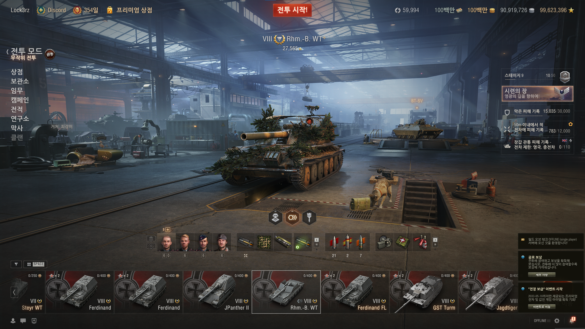

# 월드 오브 탱크 2.3.1.2 오프라인 한글 패치

**WoT 2.3.1.2 #921 EU 오프라인판**의 차고와 전투 UI를 한글로 표시합니다. 차고에서 한글이 빈칸으로 보이던 글꼴 문제의 수정이 포함되어 있습니다.



## 설치

1. 릴리스에서 `WoT-2.3.1.2-Korean.zip`을 내려받아 압축을 풉니다. [최신 릴리스](https://github.com/hillofsky/wot-2.3.1.2-korean-patch/releases/latest)
2. 게임을 종료한 상태에서 `Install-Korean.exe`를 실행합니다. 경로를 물으면 `WorldOfTanks.exe`가 들어 있는 폴더를 입력합니다.
3. `Korean UI installed` 메시지가 나오면 게임을 다시 실행합니다. LAN 플레이는 사용하던 `LAN.cmd`로 시작하면 됩니다.

백업은 게임 폴더의 `wot-ko-backup-*.zip`에 저장됩니다. 되돌리려면 게임을 종료한 후 해당 ZIP의 내용을 게임 폴더에 덮어씁니다.

공식 한국어 팩의 번역 가운데 설치된 빌드와 영어 원문이 일치하는 항목을 적용했습니다. 일부 오프라인 모드 전용 문구와 음성은 영어로 표시될 수 있습니다.

## 설치기 빌드

Windows의 .NET Framework 4.x 컴파일러로 설치기를 빌드할 수 있습니다. 실행 파일은 빌드한 뒤 릴리스 ZIP의 `manifest.tsv`, `payload/`와 같은 폴더에 둡니다.

```powershell
$compiler = Join-Path $env:SystemRoot 'Microsoft.NET\Framework64\v4.0.30319\csc.exe'
& $compiler /nologo /optimize+ /target:exe /platform:anycpu /r:System.IO.Compression.dll /r:System.IO.Compression.FileSystem.dll /out:Install-Korean.exe InstallKorean.cs
```
